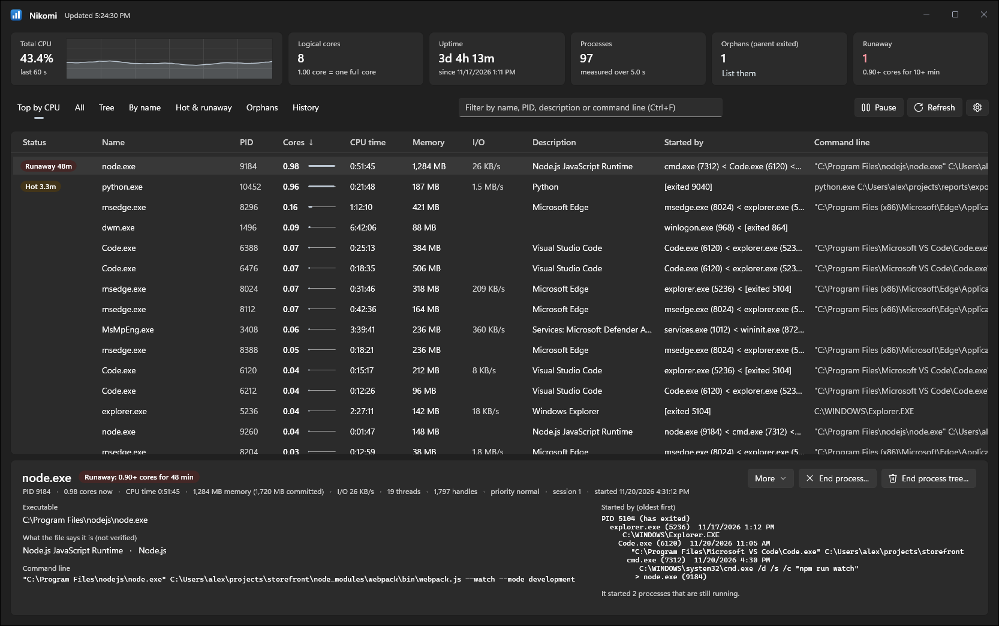

# Nikomi

A small Windows tray app that answers one question: **which process is keeping the CPU busy, and what
started it?** It watches quietly in the notification area, tells you when a process has been stuck at
full load for a long time, and lets you end it by hand.

The name is Japanese (煮込み) for a dish left to simmer: this app is for the process that has been
simmering on a core for too long.



The processes in the picture are made up: it was taken with a [demo build](docs/manual.md#screenshots),
not on a real PC.

## What it does

- Shows every process with the CPU cores it is using right now, its CPU time, memory, I/O, threads,
  handles and full command line, and says what it is: the services inside a `svchost.exe`, or the
  description in the executable.
- Shows **who started it**: the whole parent chain, and whether the parent has already exited.
- Views by process, as a **tree** (each row includes what it started) or **by name** (40 browser
  processes read as one line).
- Draws the total CPU load as a **graph**, like Task Manager: live for the last 60 seconds, and for
  the last 24 hours on the History view.
- Keeps a **history** of the last 24 hours: what was busy while you were away.
- Flags a process as a **runaway** when it holds a core for a long time (0.9 cores for 10 minutes by
  default) and shows one notification for it. Names you choose are never flagged.
- Lowers a process's priority, or ends a single process or a whole process tree after a confirmation
  that lists everything that will be ended.
- Lets **AI agents** read the same figures, if you turn that on, and ask you to end a process (see
  [For AI agents](#for-ai-agents)).

## What it does not do

- It never ends a process on its own. Every end is confirmed by you, also when an AI agent asks for it.
- It needs no administrator rights and does not ask for them.
- It makes no network connections, opens no network port and collects no telemetry.
- It shows AI agents nothing until you turn agent access on.
- It installs nothing: no service, no driver, no scheduled task. It keeps a settings file, a log and
  the history (process names and core figures, no command lines) in `%LOCALAPPDATA%\Nikomi`, and one
  per-user startup entry if you turn on "Start with Windows".

## How it works

A core library with no UI does the measuring, the runaway rule and the checks before anything is
ended, and can be tested on its own. The WinUI 3 app is a thin shell around it. Diagrams of the parts,
one measurement, the process states and how ending a process is checked are in
[docs/architecture.md](docs/architecture.md).

## For AI agents

Off until you turn it on: **Settings > Let AI agents read this data**. After that, `NikomiCli.exe`
(next to the app) answers in JSON, and also runs as a Model Context Protocol (MCP) server for agent
hosts:

```bash
app\NikomiCli.exe top --count 10 --pretty
```

```bash
app\NikomiCli.exe mcp
```

- An agent can read the load, the busiest processes and programs, process trees, runaways and the
  24-hour history.
- An agent can **ask** to end a process. Nikomi then shows you the usual confirmation, with the
  agent's reason; nothing is ended unless you confirm there.
- Command lines and file paths are left out unless you allow them separately. They can contain
  passwords, and what an agent reads goes to its AI provider.
- Both switches are a courtesy toward well-behaved agents, not a security boundary. They live in
  `settings.json`, which any program running as you can change, and an agent that can run programs
  can read the same data with Windows' own tools. What keeps processes safe is the confirmation.
- The console program talks to the app over a local named pipe. Nikomi answers only programs that run
  as your Windows account on this PC, and the console program talks only to a pipe your account owns.
  Another account on the PC can still take the pipe's name first: agents then cannot reach Nikomi,
  but that account gets nothing from it.
- Agents reach a Nikomi that runs normally. Started as administrator, Nikomi can only be reached by
  programs that run as administrator too.

Details, the full command list and how to register the MCP server are in [docs/manual.md](docs/manual.md#ai-agents).

## Download

**From the Microsoft Store:** [Nikomi in the Microsoft Store](https://apps.microsoft.com/detail/9n6kvm71lrr5).
It brings .NET with it and updates itself. The Store version keeps its settings, log and history in
its own package folder, which Windows removes when you uninstall it, and offers `NikomiCli` as a
command in any terminal.

**As a zip:**

1. Install the [.NET 10 runtime](https://dotnet.microsoft.com/download/dotnet/10.0) if you don't have it.
2. Download `Nikomi-<version>-win-x64.zip` from the [latest release](https://github.com/benexus/Nikomi/releases/latest)
   and unzip it anywhere.
3. Run `Nikomi\Nikomi.exe`.

The build is not code-signed, so Windows SmartScreen may warn the first time you run it
(More info > Run anyway). Each release lists the SHA-256 of its zip.

## Requirements

- Windows 11, x64. Windows 10 version 2004 or later is the build target but is not tested.
- To run: the .NET 10 runtime.
- To build: the .NET 10 SDK.

## Build and run

To build it yourself instead of downloading it:

```bash
dotnet publish src\Nikomi\Nikomi.csproj -c Release -o app
```

```bash
app\Nikomi.exe
```

The published folder needs no installer: it brings the Windows App SDK with it and runs as is on a PC
that has the .NET 10 runtime. Left-click the tray icon to open the window, right-click it for the menu
(Open, Settings, Mute notifications, Start with Windows, Exit). Closing the window keeps the app running
in the tray.

## Checks

```bash
dotnet run --project tests\Nikomi.Check -c Release
```

Starts its own busy-loop processes and checks the measuring, runaway, parent-chain, orphan and
end-process logic against them, plus the agent answers, the pipe and the MCP server. It ends everything
it started.

## Layout

```
src\Nikomi.Core       sampling, runaway and orphan logic, parent chains, views, history, ending, settings,
                      and what agents are answered
src\Nikomi            WinUI 3 app: tray icon, window, dialogs
src\Nikomi.Cli        NikomiCli.exe: JSON commands and the MCP server for AI agents
tests\Nikomi.Check    console program that checks the core logic with real processes
docs\manual.md        settings, startup entry, removal, and other details
docs\architecture.md  how the parts fit together, as diagrams
tools\                pack-release.ps1, which builds the release zip
```

## License

MIT. See [LICENSE](LICENSE).

The license covers this project's own code. A published build also contains Microsoft's Windows App
SDK, which stays under Microsoft's own license terms.
