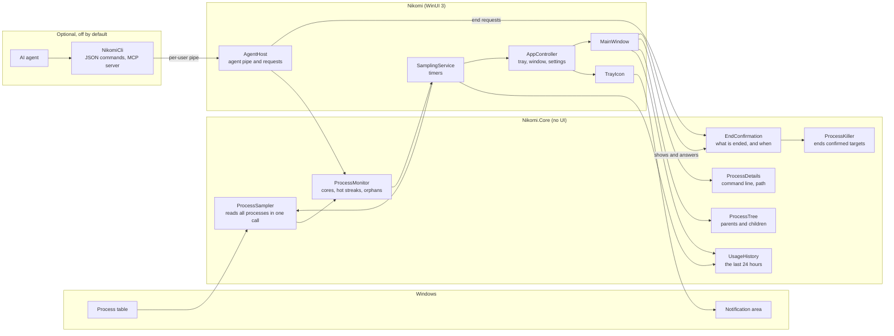
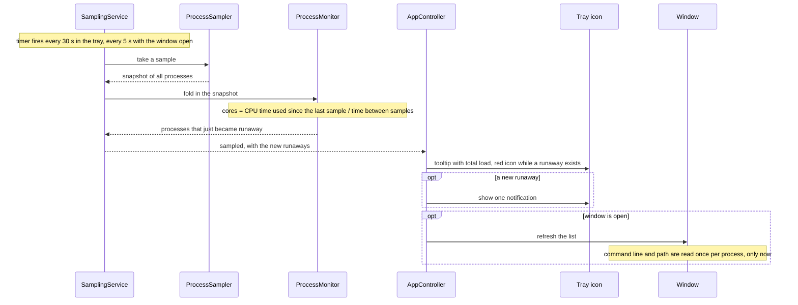
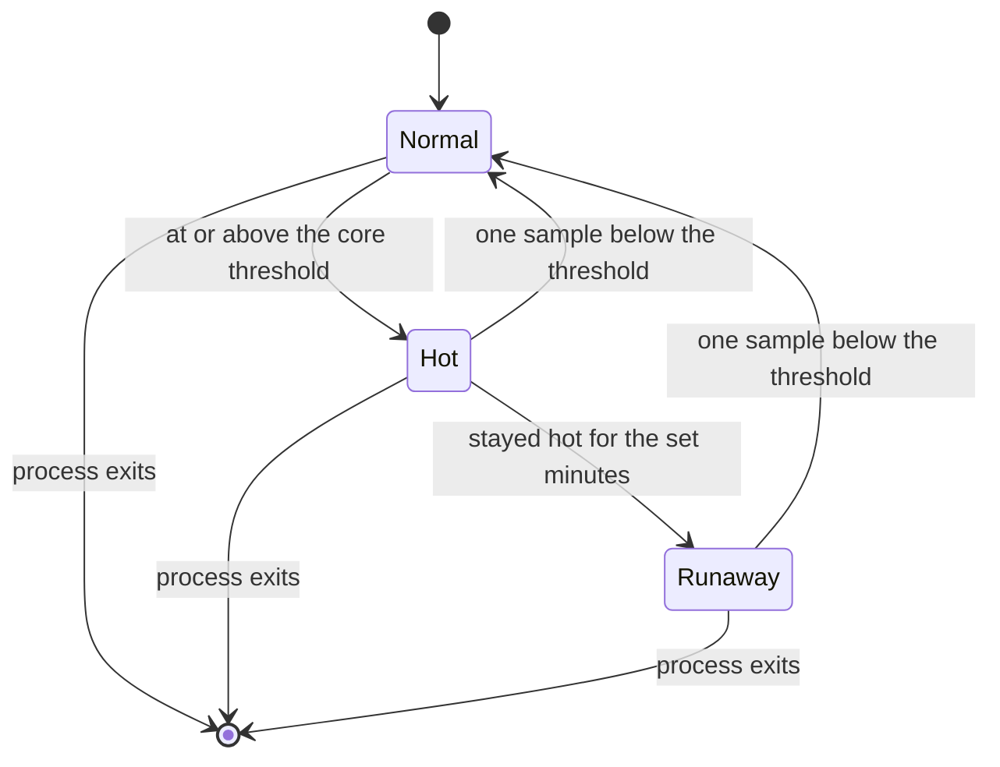
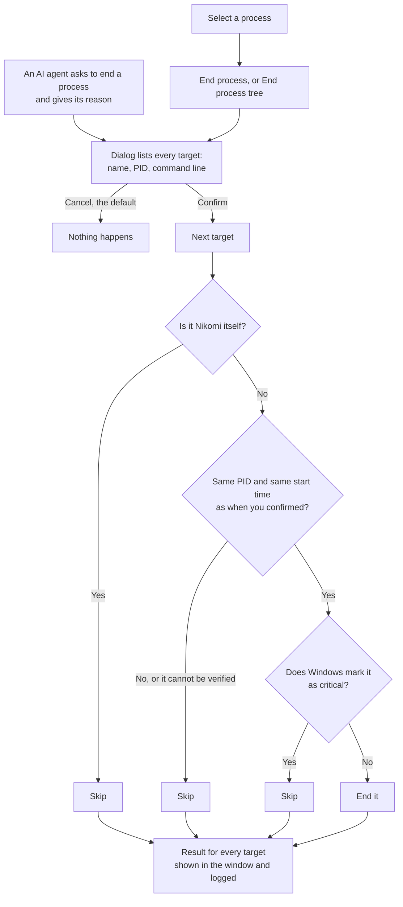

# How Nikomi works

How the parts fit together, what one measurement does, how a process becomes a runaway, and what is
checked before a process is ended. For using the app, see the [manual](manual.md).

## Parts

The core library has no UI and can be tested on its own, including what is ended and when: the window
only shows `EndConfirmation`'s dialog and reports the click. The app is a thin shell around it.

## One measurement

While the window is closed, a measurement is a single system call and opens no process handles. About
every half minute one line goes into the history: the total load and the five busiest processes.

## Process status

A process is identified by its PID **and** its start time, so a PID that Windows reuses counts as a new
process. Each process triggers at most one notification. Only a stretch of a second or more is judged,
so opening the window or clicking Refresh never resets a streak.

## Ending a process

A process Windows marks as critical is never ended, because ending one crashes the system. Processes
that belong to the system or run elevated cannot be ended without administrator rights; the result says
so instead.
